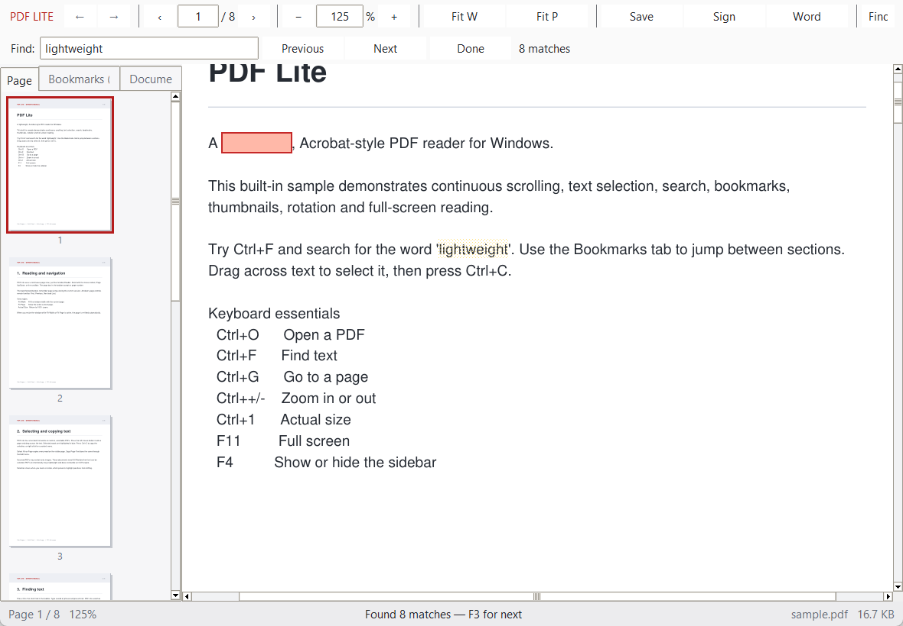

# PDF Lite

A lightweight, Acrobat-style PDF reader and editor for Windows, written in Python with
Tkinter and PyMuPDF. It opens ordinary PDFs without a browser or Electron
runtime, and adds interactive editing and writing workflows:

- **Interactive PDF editing**: text editing/replacement, text box insertion, redaction, image insertion/replacement, and table editing.
- **Hand-drawn ink signatures** placed directly on a page.
- **PDF to Word** conversion in editable-reflow or layout-faithful mode.
- **Atomic in-place saving** and **Save As** without file corruption.



## Quick start

```bat
cd C:\Users\kenhu\pdf-reader-lite
python -m pip install -r requirements.txt
run_console.bat sample.pdf
```

For normal use, double-click `run.bat`, then open a PDF with **Ctrl+O**.
`run.bat` launches without a console window. `run_console.bat` is useful for
debugging because errors stay visible.

You can also pass a PDF path directly:

```bat
run_console.bat "C:\Users\kenhu\Documents\report.pdf"
```

The built-in sample is `sample.pdf`. Generate it again at any time with:

```bat
python pdf_reader_lite.py --make-sample sample.pdf
```

## Reading features

- **Dedicated Viewing and Editing Modes**:
  - **✋ Read Mode (`Ctrl+1`)**: Optimized for reading and touch screen navigation. Dragging with fingers or mouse performs smooth canvas panning (`canvas.scan_mark` and `canvas.scan_dragto`), preventing accidental text selection. Clicking external or internal links opens them directly.
  - **I Select Mode (`Ctrl+2`)**: Dragging selects text words and lines. Upon releasing the mouse or stylus, a quick popup action menu appears right at the release position for instant **Copy**, **✎ Edit Selected Text…**, **✂ Delete (Redact)**, **Select All on Page**, **Select Entire Document**, **Copy Page Text**, and **Copy Entire Document**.
  - **✎ Click-to-Edit Mode (`Ctrl+E` / `Alt+Click`)**: Click anywhere in the document to edit lines, tables, images, or insert content at coordinates.
- **Whole-document selection and copying**:
  - `Ctrl+A`: Select all text on the active page.
  - `Ctrl+Shift+A`: Select entire document text across all pages.
  - `Ctrl+C`: Copy selected text (or current page text if nothing is selected).
  - `Ctrl+Shift+C`: Copy active page text.
  - Context menu and Edit menu commands for **Copy Entire Document** and **Select Entire Document**.
- Continuous, scrollable page view with lazy rendering
- Fit Width, Fit Page, and Actual Size (`Ctrl+0`)
- Zoom buttons, `Ctrl` + mouse wheel, and a zoom percentage field
- Page field, previous/next/first/last navigation and back/forward history
- Double-click a word to select it and show the action menu
- Full-document background search with yellow match highlights and red current match; `F3` and `Shift+F3` step through results
- PDF bookmarks/outline tree, live page thumbnails, and a document-info panel
- Link annotation clicks for internal pages and external URLs
- Page rotation, dark application chrome, and full-screen reading
- Encrypted PDFs with a password prompt
- Recent documents and remembered sidebar/dark-mode settings

## Interactive PDF editing (Text, Images, Tables)

PDF Lite supports comprehensive content modifications across any PDF:

- **Partial-Line Selected Text Editing**:
  - In **Select Mode**, drag over any specific word or phrase.
  - Choose **✎ Edit Selected Text…** from the popup menu, right-click context menu, or Edit menu.
  - Only the selected text is brought into the edit dialog with auto-detected font family, size, and color.
  - On applying changes, strictly the bounding box of the selected words is redacted and replaced with the new text. Surrounding words on the same line before and after the selection remain untouched and visible.
- **Click-to-Edit Mode**:
  - Toggle **✎ Edit Mode** on the toolbar or press **Ctrl+E** (or hold **Alt** while clicking). The cursor changes to a pencil.
  - Click **anywhere** on the page:
    - If you click on any text line, an edit dialog opens pre-filled with that line's text, typography, and color for in-place editing.
    - If you click on an image, the image management dialog opens to replace or remove it.
    - If you click on a table, the spreadsheet-like table editor opens.
    - If you click on empty space, a popup prompts to insert a new text box, image, or table at that exact coordinate.
- **Text editing and replacement**:
  - Right-click anywhere on a page and select **+ Insert Text Box Here…** (or press **Ctrl+T**) to add floating text boxes with custom typography and coordinates.
  - Select text and choose **✂ Delete (Redact) Selected Text** to redact sensitive or obsolete content with a clean background fill.
- **Image insertion and management**:
  - Right-click anywhere on a page or click **Image** (**Ctrl+I**) to insert images (*PNG*, *JPEG*, *WEBP*, *BMP*, *ICO*) with customizable position and dimensions. Images are normalized automatically through Pillow.
  - Right-click and choose **Manage Images on Page…** to view all embedded images, replace an existing image with a new file, or delete it from the page.
- **Table insertion and editing**:
  - Right-click and choose **📊 Insert Table Here…** (or click **Table**) to draw a clean structured table.
  - Choose **Edit Tables on Page…** to automatically detect tables via PyMuPDF layout analysis, then edit cell text in an interactive spreadsheet grid dialog, add/remove rows and columns, and adjust table dimensions.
- **Atomic in-place saving & Save As**:
  - Press **Ctrl+S** or click **Save** on the toolbar to save all edits directly to the open PDF file. PyMuPDF saves through an atomic replacement mechanism that prevents file corruption.
  - Press **Ctrl+Shift+S** or choose **File > Save As…** to export a copy under a new filename.

## Hand-drawn signature

1. Open a PDF and jump to the page where the signature belongs.
2. Click **Sign** (or **Tools > Hand-drawn Signature…**).
3. Draw on the white signature pad. Choose a placed size and click
   **Place Signature**.
4. Click once on the page to position the signature. Right-click or press
   **Esc** to cancel placement.
5. Press **Ctrl+S** to save the changes in place, or **Ctrl+Shift+S** to save a copy.

The signature is stored as a visible **ink annotation** in the PDF. It can be
moved or deleted later by PDF annotation editors. It is **not** a
cryptographic/digital signature and does not prove identity or document
integrity. For a legally binding digital signature, use a certificate-based
workflow in Acrobat or a dedicated e-signature service.

## PDF to Word

Use **Tools > Convert PDF to Word…** or **Ctrl+Shift+E**. Two modes are offered:

| Mode | What it does | When to use |
|---|---|---|
| Editable reflow | Rebuilds text as normal Word paragraphs and headings; page positioning and images are not retained | Best when you need to edit text |
| Layout-faithful | Uses LibreOffice Writer's PDF import to keep the page layout; text usually lives in text frames | Best when visual placement matters more than easy reflow |

**Editable reflow** is built in and needs no external office suite. It works on
PDFs with a real text layer. Scanned image-only PDFs need OCR first, which this
reader does not bundle.

**Layout-faithful** mode requires LibreOffice. PDF Lite checks the standard
install paths and also `%USERPROFILE%\Apps\LibreOfficePortable\...`, which is
where this machine's portable LibreOffice lives. If LibreOffice is not found,
the option is disabled and reflow remains available.

The conversion writes a new `.docx` file. The PDF itself is never modified.
During conversion, a live determinate progress bar and status indicator report
which page is actively being converted (`Converting page X of Y…`), percentage
completion, and current status.

## Set as default Windows PDF reader

To register PDF Lite with Windows so it appears in the **Open with** list and **Default apps**:

1. Run [`register_default.bat`](file:///C:/Users/kenhu/pdf-reader-lite/register_default.bat).
2. When the Windows **Default apps** settings panel opens, search for `.pdf` and select **PDF Lite**.
3. Alternatively, right-click any `.pdf` file in File Explorer, choose **Open with > Choose another app**, select **PDF Lite Document**, and check **Always use this app to open .pdf files**.

To cleanly remove the registration later, run [`unregister.bat`](file:///C:/Users/kenhu/pdf-reader-lite/unregister.bat).

## Keyboard shortcuts

| Keys | Action |
|---|---|
| `Ctrl+O` | Open a PDF |
| `Ctrl+S` | Save PDF changes in place |
| `Ctrl+Shift+S` | Save As (new copy) |
| `Ctrl+1` | Read Mode (touch screen / pan browsing) |
| `Ctrl+2` | Select Mode (text selection & quick popup menu) |
| `Ctrl+E` | Toggle Click-to-Edit mode |
| `Alt+Click` | Click anywhere on document to edit element |
| `Ctrl+T` | Add text box |
| `Ctrl+I` | Insert image |
| `Ctrl+Shift+E` | Convert PDF to Word |
| `Ctrl+W` | Close the document |
| `Ctrl+F` | Find text |
| `F3` / `Shift+F3` | Find next / previous |
| `Ctrl+G` | Go to page |
| `Ctrl+C` | Copy selected text (or active page text if nothing selected) |
| `Ctrl+Shift+C` | Copy active page text |
| `Ctrl+A` | Select all text on the active page |
| `Ctrl+Shift+A` | Select entire document text across all pages |
| `Ctrl++` / `Ctrl+-` | Zoom in / out |
| `Ctrl+0` | Actual size (100%) |
| `Ctrl+R` | Rotate clockwise |
| `Ctrl+Shift+R` | Rotate counter-clockwise |
| `Page Up` / `Page Down` | Previous / next page |
| `Right` / `Left` | Next / previous slide or page |
| `Down` / `Up` | Next / previous slide (scrolls in portrait documents) |
| `Space` | Scroll one viewport |
| `Ctrl+Home` / `Ctrl+End` | First / last page |
| `F4` | Show or hide the sidebar |
| `F11` / `Esc` | Enter / leave full screen |

## Diagnostics

Headless engine and feature test:

```bat
python pdf_reader_lite.py --selftest sample.pdf
```

The self-test checks page access, text extraction, search, rendering, saving an
ink signature, and Word conversion. Expected output ends with `[selftest] PASS`.

GUI smoke test (opens the PDF, searches, zooms, saves a screenshot, exits):

```bat
python pdf_reader_lite.py --smoke smoke.png sample.pdf
```

The current machine was verified with Python 3.13, PyMuPDF 1.27.2.3,
Pillow 12.3, python-docx, and LibreOffice 26.2.1.2.

## Design notes

- GUI only: Tkinter, no browser or Electron runtime.
- PDF engine: PyMuPDF, with per-page lazy rendering and a bounded image cache.
- Word export: python-docx for reflow; optional LibreOffice CLI for layout.
- Settings and recent files live in `%APPDATA%\PDF Lite`.
- No telemetry and no network access except when you explicitly open an
  external link.

## Limitations

- Form filling, OCR, digital certificates, and full PDF page reorganization are out of scope.
- Editable-reflow Word output approximates formatting; complex multi-column
  layouts, tables and images will not survive perfectly.
- The reader renders pages as images, so very high zoom uses more memory.
- Ink signatures are annotations, not cryptographic signatures.

## Security controls & hardening

PDF Lite has undergone thorough static AST analysis and automated security scans with 0 identified vulnerabilities and verified zero-backdoor architecture:

- **Zero-Backdoor & Offline-First Guarantee**: PDF Lite contains zero telemetry, zero analytics, zero external network sockets, and zero background network calls. All rendering, editing, and conversion workflows execute 100% locally on the host machine.
- **XXE & XML Entity Expansion Defense**: Word document layout parsing explicitly rejects `<!DOCTYPE` and `<!ENTITY` declarations before XML processing, neutralizing XML External Entity (XXE) and XML bomb attacks.
- **NetNTLM Hash Leak Protection (UNC Path Blocking)**: All file open, save, copy, image insertion, and Word export entry points reject UNC network paths (`\\server\share` and `//server/share`). This prevents Windows from automatically initiating SMB authentication and leaking NTLM credentials across networks.
- **Strict URI Scheme Whitelisting**: External hyperlinks embedded in PDF documents are restricted exclusively to standard `http://` and `https://` web schemes. Dangerous protocols such as `file:`, `javascript:`, `ms-msdt:`, `data:`, `powershell:`, and `cmd:` are blocked.
- **Link Display Sanitization**: Link strings are stripped of non-printable characters, carriage returns, and newlines, and truncated before prompting to prevent dialog spoofing or clickjacking.
- **Decompression Bomb Protection**: Embedded image insertions are constrained to 4,096 pt per dimension and 32 megapixels total, with automatic downsampling through Pillow to prevent memory exhaustion DoS.
- **Archive Safety (Zip Slip & Zip Bomb Defense)**: Word DOCX layout processing inspects all zip entries for directory traversal sequences (`..`) and enforces a 64 MB uncompressed limit per entry and a 256 MB total uncompressed archive boundary.
- **Finite Coordinate Validation**: All editing coordinates and bounding boxes are validated to be finite real numbers. Passing `NaN` or `Inf` raises immediate validation errors rather than generating corrupt PDF structures.
- **Atomic In-Place Saving**: In-place saves use temporary file staging and atomic replacement, ensuring documents cannot be left in a corrupted or zero-byte state if interrupted.
- **Command-Line Argument Injection Defense**: Filenames starting with dashes or slashes are rejected by conversion routines to prevent option injection in underlying utilities.

## Standalone executable build

PDF Lite can be packaged into a self-contained `.exe` with the bundled Acrobat-style icon:

```bat
build_exe.bat
```

This builds a standalone binary at [`dist/PDF Lite.exe`](file:///C:/Users/kenhu/pdf-reader-lite/dist/PDF%20Lite.exe) (~43.9 MB) with:
- The custom icon embedded from [`assets/icon.ico`](file:///C:/Users/kenhu/pdf-reader-lite/assets/icon.ico)
- Fast startup with only runtime dependencies bundled (PyMuPDF, Pillow, python-docx)
- Windowed mode (no console popup)
- Zero external Python installation required on target systems

## Windows Installer (.msi) packaging

To distribute and sell PDF Lite commercially, compile the Windows Installer (`.msi`) package using the bundled WiX 3.11 toolchain:

```bat
build_msi.bat
```

The build script compiles [`installer/Product.wxs`](file:///C:/Users/kenhu/pdf-reader-lite/installer/Product.wxs) into a production-grade, self-contained installer at [`dist/pdf-lite.msi`](file:///C:/Users/kenhu/pdf-reader-lite/dist/pdf-lite.msi) (~44 MB):

- **Installation Directory**: Installs directly to `%LOCALAPPDATA%\Programs\PDF Lite\` (64-bit native, requires zero admin privileges for seamless customer installation), and supports machine-wide deployment (`ALLUSERS=1`).
- **Start Menu & Desktop Shortcuts**: Automatically creates branded shortcuts with the high-resolution application icon in the Start Menu and Desktop.
- **Windows File Association & Default Apps**: Registers the `PDFLite.Document` ProgId, `.pdf` extension, and application capabilities under `HKCU\Software\RegisteredApplications` and `OpenWithProgids` for seamless Windows 10/11 **Default Apps** integration.
- **Standard Setup Wizard**: Includes an End-User License Agreement ([`installer/license.rtf`](file:///C:/Users/kenhu/pdf-reader-lite/installer/license.rtf)), installation folder selection, progress display, and an optional "Launch PDF Lite now" checkbox on exit.
- **Clean Uninstallation**: Fully integrated with Windows **Settings > Apps > Installed apps** and Add/Remove Programs with proper application metadata, icon, publisher details (`Ken Huang`), and complete file/shortcut/registry cleanup on uninstall.
